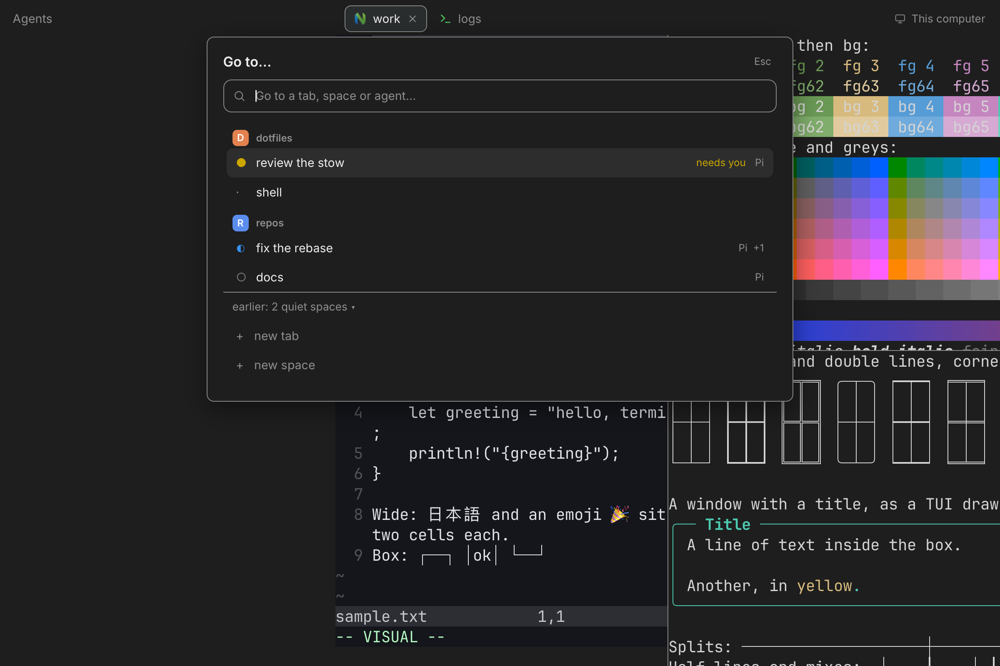
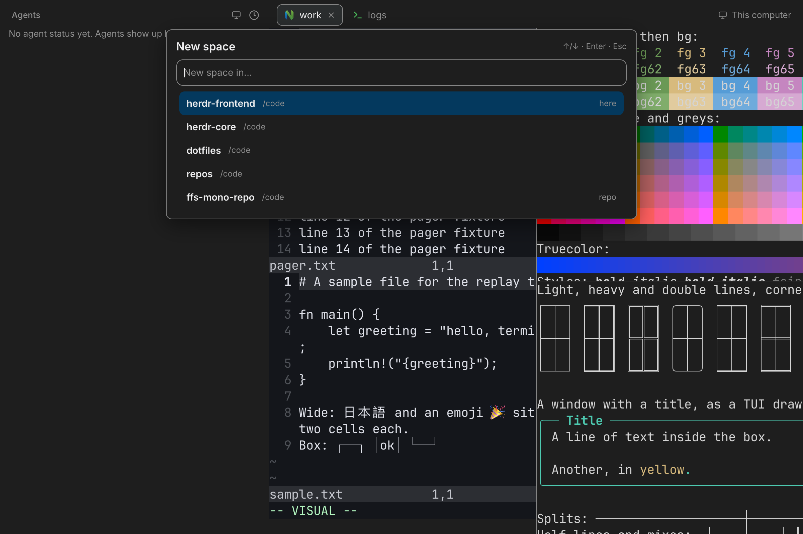
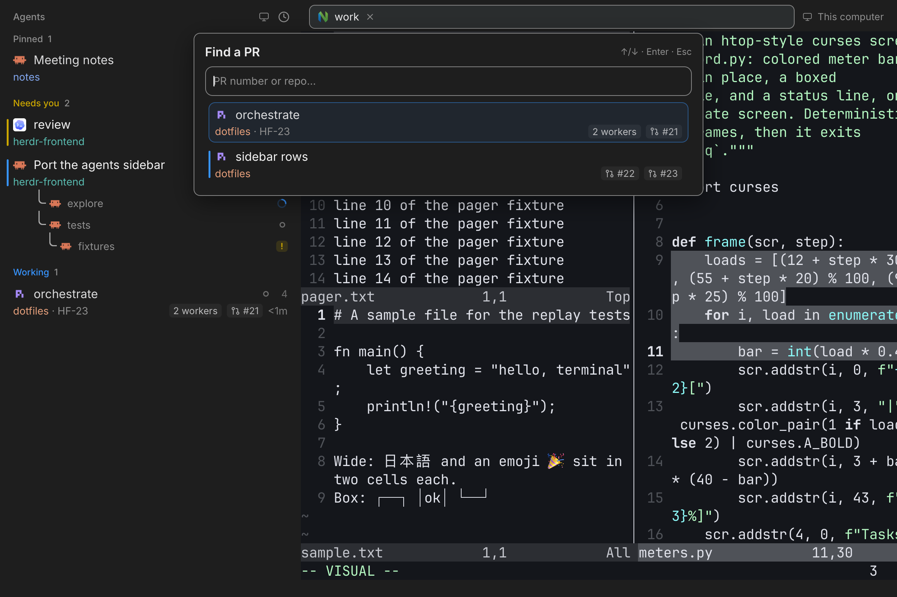

# Popups: the palette, the pickers, dialogs and menus

The popups of `research/feature-inventory.md` §3, §9, §10, §11 and §12, as herdr-frontend draws
them. They share one frame and one list, so a popup is a row builder and a body, not a new
overlay. The machine popups are described in `docs/machines.md`.

## How a popup works

- **The model holds the keyboard** while one is open (`model::Mode::Popup`, `docs/keys.md`
  "Modes"). Its states: `List` (a query, a cursor, a row count), `Prompt`, `Confirm` and `Menu`
  (items that carry the actions they run). The keys each one reads are `model::mode::popup_key`.
- **Rows are pure model code** (`crates/model/src/popups.rs`, `folders.rs`, `prs.rs`): what each
  popup lists, where its cursor starts, and what picking a row runs (`PickerRow::action`,
  `PaletteRow::action`, `MenuItem::actions`, `new_space_pick`). The window passes only what it
  alone knows: the programs' names from `programs.json`, for the picker, and the Agents list it
  builds (`model::agents::List`), for the PR finder.
- **The window draws** (`crates/app/src/view/popup.rs`). After every step (a key, core news, a
  control call) and before a click picks a row, it counts an open list's rows again and tells
  the model (`Event::PopupRows`), so a tab or space made or closed elsewhere is reachable at once
  and a click picks the row drawn. When the list opens or its query changes it also says where
  the cursor starts (`Event::PopupCursor`). Enter closes a list and sends
  `Effect::Pick`; the window runs the picked row's action as a step of its own, after the step's
  other effects, so a pick that opens a prompt keeps the prompt's focus.
- **Every `Prompt`, `Confirm` and `Menu` draws the same way**, whichever feature opened it. A
  feature that needs a menu builds `model::Menu` items and opens it; it draws no overlay.

## Where the folders and PRs come from

- **Folders.** When the new-space picker opens, the model asks the shown space's machine
  (`machine.exec`, `on` it when it's another machine, 5 s each) for `zoxide query -l`, the repos
  config (`sh -c 'cat "${XDG_CONFIG_HOME:-$HOME/.config}/repos/config.json"'`) and, on another
  machine, `sh -c 'printf %s "$HOME"'` for `~`. A lookup that fails or exits non-zero counts as
  empty. Nothing is walked, so the focused folder shows at once and the rest when they answer.
  The commands run in herdr-core's environment on that machine, as Ctrl+H/J/K/L's `nvim` does;
  Herdr app runs local ones in its own process with the person's login environment.
- **PRs.** From each Pi's `dotfiles.pi_pr_watch` label (trusted only while the terminal runs Pi):
  its `prs` (display names like `#1901` or `tool#7`) and `refs` (`owner/repo#N`). A Pi from
  before `refs` names its own repo's PRs `#N` only, so the space name's repo stands in. A
  `merge of #N` sha watch counts as that PR when nothing else is watched. No `gh` call is made:
  the mod reads labels only.

## The frame and the list

`crates/app/src/view/overlay.rs` is Herdr app's overlay frame (`app/src/window.rs`
`render_overlays`): a box in the popover color with a 1 pt border, radius 8 and a shadow.

| Kind | Where | Behind it |
| --- | --- | --- |
| Dialog (prompt, confirm, keys help, settings) | centered | the window, dimmed 35% |
| Popup (pickers, palette) | centered across, `offset` from the top, at most a share of the window tall | nothing |
| Menu | at the last right-click, kept inside the window | nothing |

A press outside closes it (a right-click too); a press inside stays inside. A right-click on a
tab pill opens the tab menu (`Menu::tab`); one on a pane opens the terminal menu, unless its
terminal takes right-clicks (`herdr.right-click=program`, Shift+right-click still opens it).
Either opens where the right-click was. The keyboard goes to
the popup's text field (`popup-filter`), or to the box itself when it has none (confirm, menus,
settings). The field is one `TextEdit` in the state: a list's filter, or the prompt's name.

`crates/app/src/view/list.rs` is the list the pickers, the palette and settings share. Rows the
cursor reaches and group titles it skips are `Item`s; a window of rows follows the cursor, moving
only as far as it must (a row that opens a group shows with its title), as Herdr app's lists
scroll. A press on a row picks it; the wheel moves the cursor a row per 32 points.

## Matching

Every typed filter but the keys help's uses Eli's matching (`crates/model/src/filter.rs`, a port
of `cfg/mods/space-picker/match.js`): each space-separated term must match, in any order, and a
term's letters match in order. The item's name counts first, then its other fields. Within a
field, a whole field beats a word start, which beats a match mid-word, which beats scattered
letters; shorter fields win; ties keep the list's order.

| Popup | Name | Other fields |
| --- | --- | --- |
| Space picker | the space's name | its folder (`~` for home), its machine |
| Picker | the tab's name | its space's name, its agents' programs |
| Palette | the command's title | its group, command name and keywords |

Herdr app's picker filters by substring and its palette by its own fuzzy score; herdr-frontend
uses Eli's matching for both. The space picker also matches a space's git branch in Herdr app;
herdr-frontend reads no branches yet.

The new-space picker and the PR finder keep their mods' own matching:

- **Folders** (`crates/model/src/folders.rs`, a port of `cfg/mods/new-space/folders.js`): every
  term must match the folder as shown (`~` for home), its letters in order. A term in the last
  segment beats one elsewhere, a segment start beats mid-word, shorter names win, ties keep the
  gathered order. A typed `/…`, `~` or `~/…` path is offered first, tagged "path".
- **PRs** (`crates/model/src/prs.rs`, a port of `cfg/mods/pr-finder/match.js`): terms split on
  whitespace and `#`, and every term must match one PR. A number matches the PR's number (exact,
  then a prefix, then inside it); a word matches the repo (its name exact, then its start, then
  anywhere in `owner/repo`, then its letters in order: "fmr" finds ffs-mono-repo). Rows rank by
  their best PR and keep the PRs that matched; ties keep the Agents list's order.

## The popups

| Popup | Keys | Size | Rows | Enter |
| --- | --- | --- | --- | --- |
| Command palette | `cmd-shift-p` | 620 wide, 60 from the top, ≤ 0.85 | Empty: up to 5 recent commands, then every group (Tab, Pane, Space, Layout, Terminal, Agent, Window, App), each with its first key. Typed: matches, best first, recent first among equals, each with its group. 10 show; ↑/↓ stop at the ends; Page Up/Down move 10. | Runs it (`Action::FromPalette`), remembered among the recent commands in the saved view. A command that needs a name asks in the prompt. |
| Tab and agent picker | `cmd-p` | 640 wide, 40 from the top, ≤ 0.8 | Spaces with an agent first (one that needs you first), each under its avatar (first emoji or letter, in the space's color, as the sidebar keeps it) and its tabs: status glyph, name (semibold when shown), "needs you" / "finished", the agents' programs and "+N" sub-agents. Then "earlier: N quiet spaces ▾", then "new tab", "new space" and "new space on <machine>" per connected machine. 10 show. | Shows the tab; makes a tab or space. "earlier" unfolds and stays open. Ctrl+D closes the selected tab. |
| Space picker | `ctrl-g s` | 520 wide, 40 from the top, ≤ 0.6 | Number (1-9), status glyph, name (semibold when shown), machine when remote, "N tabs". Opens on the shown space, and goes back to it when the field empties. 12 show, with "↑ N more" / "↓ N more". | Shows the space, on its first terminal tab when its selected tab is an agent's or the review's. |
| New space in a folder | `cmd-n`, `ctrl-g ctrl-s` | 640 wide, 40 from the top, ≤ 0.6; "New space" or "New space on <machine>" | The focused terminal's folder ("here"), then `zoxide query -l` in frecency order, then the `repos` config's paths zoxide hasn't seen ("repo"). Each row: the folder's name (semibold), its parent (dim, `~` for home) and its tag. 12 show, with "↓ N more"; "Loading folders…" until the lookups answer. | Makes a space there and shows it (`space.new {machine, folder}`). With nothing matching, where plain `space.new` starts; while loading with nothing matching, Enter waits. |
| PR finder | `ctrl-g f` | 620 wide, 40 from the top, ≤ 0.6; "Find a PR" | Agents watching a PR, in the Agents list's order, minus hidden machines. Each reads like an Agents row without status, jump label or time: icon, title, the space in its color, the ticket and "N workers" for an orchestrator, up to 3 matched PR chips and "+N", the machine; a live agent keeps its status edge. 9 show, with "↓ N more". Empty: "No agent is watching a PR" / "No agent watches a PR like that". | Focuses that agent (a click too). |
| Prompt | `f2`, `ctrl-g r`, `shift-f2`, the terminal menu's Rename | 380 wide dialog | "Rename tab" / "Rename space" / "Rename pane", a "Name" field holding the name, selected, and a hint ("empty: its number" / "empty: named after its folder" / "empty: unnamed"), Cancel and Save. A second rename closes it. | Saves the trimmed name; empty goes back to the automatic one (a pane: no name). |
| Confirm | `ctrl-g x`, closing a space's last tab | 380 wide dialog | "Close space?", "<name> — N tabs, M terminals", Cancel and Confirm. | Closes the space and ends its terminals. |
| Tab menu | right-click a tab | 200 wide menu | Rename, New tab, Close, each with its icon and key. | Runs the item. |
| Terminal menu | right-click a pane | 220 wide menu | Rename, Split right, Split down, Zoom; "Send right-clicks to pane" or "Use Herdr right-click menu"; "Send back to <parent>" for a sub-agent kept in a pane; Close pane. Pane items are left out for a terminal outside a tab. | Runs the item on that pane. |
| Settings | `cmd-,`, `ctrl-g c` | 520 wide dialog | `settings.json`, `keys.json`, `programs.json` and the theme's file (when the theme came from the home's `themes/`, or the settings name one that isn't built in), each with its path; what is wrong with the files now; "Machines"; "Show the home folder". | Opens the file in a new tab running `$EDITOR`, else Neovim; the window follows the saved file. "Machines" opens the Machines dialog. The last row shows the home in Finder. |
| Keys help | `cmd-/` | 640 × 520 dialog | `docs/keys.md` "Keys help". | — |
| Sort menu | the sidebar's sort button | under that button, in the sidebar's own frame (`view::sidebar`) | The sorts, the current one checked. | Sorts the Agents list. |
| Agent-jump bar | `ctrl-;` | 360 × 32, 6 from the top (8 window points at least) | No rows: "JUMP", the labels it takes ("1–9 · 0 · a s d · Esc"), the letter typed so far; the sidebar's rows show their labels, bright (`docs/sidebar.md`). | No Enter: a whole label focuses its row. |
| Copy mode's bar | `ctrl-g [` | 420 × 32, 6 from the top (8 window points at least) | No rows: COPY, VISUAL, VISUAL LINE or VISUAL BLOCK; the hints, the `/` prompt or the last message; the keys typed so far; the cursor's row of all rows. The cursor and selection draw in the terminal (`docs/keys.md` "Modes"). | Copies the selection and leaves; with none, leaves. |
| Machine filter | `ctrl-g /`, the sidebar's monitor button | 340 wide, 40 from the top, ≤ 0.5 | "All machines", this computer, each machine: a checkbox, "offline", the agent count, "⏎ only" on the cursor's row. J/K move too; Space or a click shows or hides one. | Shows only that machine (or all) and closes. |
| Machines | the palette, the settings dialog's Machines row | 520 wide dialog | This computer and each machine: its line, hc version and what it needs run; "Add a machine". | Opens the machine's menu (Connect now, Copy <command>, Rename, Remove), or the add dialog. |
| Add a machine | the palette, the Machines dialog | 560 wide dialog | A `user@host` field over the ssh config's hosts not added yet, then "Add <typed>". A row says when it's connecting and what went wrong. | Adds the machine and stays open; copies `hc machine add <target>` when it needs a terminal. |

Menus show each item's `global` key, as the keys help lists it (single keys before sequences).
"Send right-clicks to pane" sets the terminal's `herdr.right-click=program` label, which Herdr
app reads too; "Use Herdr right-click menu" clears it. "Send back to <parent>" is
`terminal.park`: the terminal's `herdr.space` and `herdr.tab` labels are cleared, then keep is
turned off, then its pane goes; the terminal keeps running under its parent.

The settings dialog lists files instead of editing values: herdr-frontend is set up by files
(`docs/settings.md`, `docs/keys.md`), and Herdr app's 880 pt settings window has no counterpart.
The editor runs as `/bin/sh -c 'exec ${EDITOR:-nvim} "$1"' sh <file>` on this computer: in the
shown space when it is this computer's, else the first of this computer's spaces, else a new one.

## Pane names

The terminal menu's Rename is Herdr app's `pane.rename` (since 0.1.17; read at 0.1.18). The name is
the pane's block `title` in the shared `herdr-app` document (`app:src/layout.rs` `Node::title`),
written as Herdr app's `pane.rename` writes it (`app:src/window.rs`): trimmed, and an empty name
removes `title` rather than writing `""`. Each app reads a name the other one wrote, and the name
moves with its pane on swaps and drags. Herdr app shows pane names in its stock `pane` header mod
and gives them to mods (`panes()[].name`, `agents()[].pane_name`). Eli's layout has no pane
headers, and none of his mods read pane names (`feature-inventory.md` §5), so herdr-frontend shows
the name only in the rename prompt, as its starting value.

## Not yet

- The picker's working spinner is a static ◐ glyph, as the space picker draws it.

## Scenes

`just snap <scene>`: `shell-palette`, `shell-palette-typed`, `shell-picker`,
`shell-picker-earlier`, `shell-space-picker`, `shell-space-picker-typed`, `shell-new-space`,
`shell-new-space-typed`, `shell-pr-finder`, `shell-pr-finder-typed`, `shell-prompt`,
`shell-confirm`, `shell-tab-menu`, `shell-terminal-menu`, `shell-settings`, `shell-keys-help`,
`shell-machine-filter`, `shell-machines`, `shell-machine-add`.
The picker scenes run on `fixtures::busy_core`: agents in other spaces, one that needs you, a
working one with a sub-agent, and a quiet space. The new-space scenes run on
`fixtures::folders_core`, whose machine answers the folder lookups; the PR finder's on
`fixtures::agents_core`, where a Pi orchestrator and its worker watch PRs.

