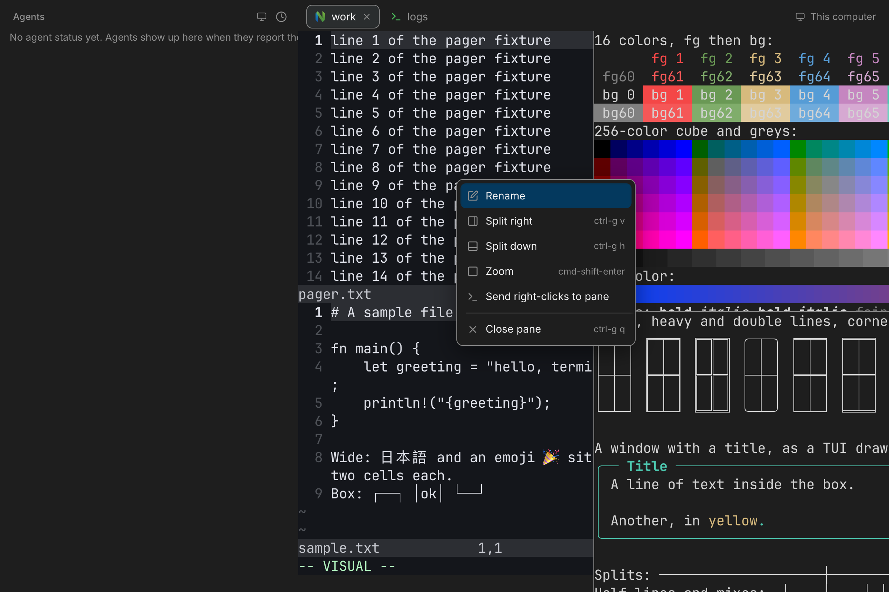

# Popups: the palette, the pickers, dialogs and menus

The popups of `research/feature-inventory.md` §3 and §10, as herdr-frontend draws them. They share
one frame and one list, so the popups later tickets add (the new-space folder picker, the PR
finder, the machine filter) are a row builder and a body, not a new overlay.

## How a popup works

- **The model holds the keyboard** while one is open (`model::Mode::Popup`, `docs/keys.md`
  "Modes"). Its states: `List` (a query, a cursor, a row count), `Prompt`, `Confirm` and `Menu`
  (items that carry the actions they run). The keys each one reads are `model::mode::popup_key`.
- **Rows are pure model code** (`crates/model/src/popups.rs`): what each popup lists, where its
  cursor starts, and what picking a row runs (`PickerRow::action`, `PaletteRow::action`,
  `MenuItem::actions`). The window passes only what it alone knows: the programs' names from
  `programs.json`, for the picker.
- **The window draws** (`crates/app/src/view/popup.rs`). After every step (a key, core news, a
  control call) and before a click picks a row, it counts an open list's rows again and tells
  the model (`Event::PopupRows`), so a tab or space made or closed elsewhere is reachable at once
  and a click picks the row drawn. When the list opens or its query changes it also says where
  the cursor starts (`Event::PopupCursor`). Enter closes a list and sends
  `Effect::Pick`; the window runs the picked row's action as a step of its own, after the step's
  other effects, so a pick that opens a prompt keeps the prompt's focus.
- **Every `Prompt`, `Confirm` and `Menu` draws the same way**, whichever feature opened it. A
  feature that needs a menu builds `model::Menu` items and opens it; it draws no overlay.

## The frame and the list

`crates/app/src/view/overlay.rs` is Herdr app's overlay frame (`app/src/window.rs`
`render_overlays`): a box in the popover color with a 1 pt border, radius 8 and a shadow.

| Kind | Where | Behind it |
| --- | --- | --- |
| Dialog (prompt, confirm, keys help, settings) | centered | the window, dimmed 35% |
| Popup (pickers, palette) | centered across, `offset` from the top, at most a share of the window tall | nothing |
| Menu | at the last right-click, kept inside the window | nothing |

A press outside closes it (a right-click too); a press inside stays inside. A right-click on a
tab pill opens the tab menu (`Menu::tab`); one on a pane opens the terminal menu, unless its
terminal takes right-clicks (`herdr.right-click=program`, Shift+right-click still opens it).
Either opens where the right-click was. The keyboard goes to
the popup's text field (`popup-filter`), or to the box itself when it has none (confirm, menus,
settings). The field is one `TextEdit` in the state: a list's filter, or the prompt's name.

`crates/app/src/view/list.rs` is the list the pickers, the palette and settings share. Rows the
cursor reaches and group titles it skips are `Item`s; a window of rows follows the cursor, moving
only as far as it must (a row that opens a group shows with its title), as Herdr app's lists
scroll. A press on a row picks it; the wheel moves the cursor a row per 32 points.

## Matching

Every typed filter but the keys help's uses Eli's matching (`crates/model/src/filter.rs`, a port
of `cfg/mods/space-picker/match.js`): each space-separated term must match, in any order, and a
term's letters match in order. The item's name counts first, then its other fields. Within a
field, a whole field beats a word start, which beats a match mid-word, which beats scattered
letters; shorter fields win; ties keep the list's order.

| Popup | Name | Other fields |
| --- | --- | --- |
| Space picker | the space's name | its folder (`~` for home), its machine |
| Picker | the tab's name | its space's name, its agents' programs |
| Palette | the command's title | its group, command name and keywords |

Herdr app's picker filters by substring and its palette by its own fuzzy score; herdr-frontend
uses Eli's matching for both. The space picker also matches a space's git branch in Herdr app;
herdr-frontend reads no branches yet.

## The popups

| Popup | Keys | Size | Rows | Enter |
| --- | --- | --- | --- | --- |
| Command palette | `cmd-shift-p` | 620 wide, 60 from the top, ≤ 0.85 | Empty: up to 5 recent commands, then every group (Tab, Pane, Space, Layout, Terminal, Agent, Window, App), each with its first key. Typed: matches, best first, recent first among equals, each with its group. 10 show; ↑/↓ stop at the ends; Page Up/Down move 10. | Runs it (`Action::FromPalette`), remembered among the recent commands in the saved view. A command that needs a name asks in the prompt. |
| Tab and agent picker | `cmd-p` | 640 wide, 40 from the top, ≤ 0.8 | Spaces with an agent first (one that needs you first), each under its avatar (first emoji or letter, in the picker's space color) and its tabs: status glyph, name (semibold when shown), "needs you" / "finished", the agents' programs and "+N" sub-agents. Then "earlier: N quiet spaces ▾", then "new tab", "new space" and "new space on <machine>" per connected machine. 10 show. | Shows the tab; makes a tab or space. "earlier" unfolds and stays open. Ctrl+D closes the selected tab. |
| Space picker | `ctrl-g s` | 520 wide, 40 from the top, ≤ 0.6 | Number (1-9), status glyph, name (semibold when shown), machine when remote, "N tabs". Opens on the shown space, and goes back to it when the field empties. 12 show, with "↑ N more" / "↓ N more". | Shows the space, on its first terminal tab when its selected tab is an agent's or the review's. |
| Prompt | `f2`, `ctrl-g r`, `shift-f2` | 380 wide dialog | "Rename tab" / "Rename space", a "Name" field holding the name, selected, and a hint ("empty: its number" / "empty: named after its folder"), Cancel and Save. A second rename closes it. | Saves the trimmed name; empty goes back to the automatic one. |
| Confirm | `ctrl-g x`, closing a space's last tab | 380 wide dialog | "Close space?", "<name> — N tabs, M terminals", Cancel and Confirm. | Closes the space and ends its terminals. |
| Tab menu | right-click a tab | 200 wide menu | Rename, New tab, Close, each with its icon and key. | Runs the item. |
| Terminal menu | right-click a pane | 220 wide menu | Rename, Split right, Split down, Zoom; "Send right-clicks to pane" or "Use Herdr right-click menu"; "Send back to <parent>" for a sub-agent kept in a pane; Close pane. Pane items are left out for a terminal outside a tab. | Runs the item on that pane. |
| Settings | `cmd-,`, `ctrl-g c` | 520 wide dialog | `settings.json`, `keys.json`, `programs.json` and the theme's file (when the theme came from the home's `themes/`, or the settings name one that isn't built in), each with its path; what is wrong with the files now; "Show the home folder". | Opens the file in a new tab running `$EDITOR`, else Neovim; the window follows the saved file. The last row shows the home in Finder. |
| Keys help | `cmd-/` | 640 × 520 dialog | `docs/keys.md` "Keys help". | — |
| Sort menu | the sidebar's sort button | under that button, in the sidebar's own frame (`view::sidebar`) | The sorts, the current one checked. | Sorts the Agents list. |

Menus show each item's `global` key, as the keys help lists it (single keys before sequences).
"Send right-clicks to pane" sets the terminal's `herdr.right-click=program` label, which Herdr
app reads too; "Use Herdr right-click menu" clears it. "Send back to <parent>" is
`terminal.park`: the terminal's `herdr.space` and `herdr.tab` labels are cleared, then keep is
turned off, then its pane goes; the terminal keeps running under its parent.

The settings dialog lists files instead of editing values: herdr-frontend is set up by files
(`docs/settings.md`, `docs/keys.md`), and Herdr app's 880 pt settings window has no counterpart.
The editor runs as `/bin/sh -c 'exec ${EDITOR:-nvim} "$1"' sh <file>` on this computer: in the
shown space when it is this computer's, else the first of this computer's spaces, else a new one.

## Not yet

- The terminal menu's "Rename" says "not yet": pane names need a field in the shared layout
  document that herdr-shared doesn't model yet.
- The picker's working spinner is a static ◐ glyph, as the space picker draws it.
- The picker's space colors are assigned in space order each time, the way a new space's color is
  picked. Keeping each space's color once chosen, so adding a space moves nothing, comes with the
  sidebar's space colors (ticket 023), kept in herdr-frontend's home.

## Scenes

`just snap <scene>`: `shell-palette`, `shell-palette-typed`, `shell-picker`,
`shell-picker-earlier`, `shell-space-picker`, `shell-space-picker-typed`, `shell-prompt`,
`shell-confirm`, `shell-tab-menu`, `shell-terminal-menu`, `shell-settings`, `shell-keys-help`.
The picker scenes run on `fixtures::busy_core`: agents in other spaces, one that needs you, a
working one with a sub-agent, and a quiet space.

