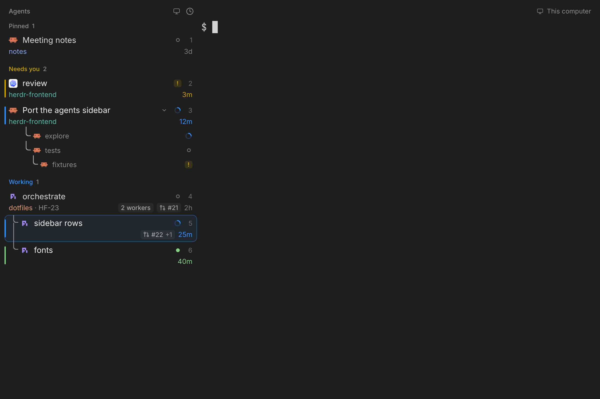

# The Agents sidebar

The sidebar is Eli's `eli-chrome` top row over his `eli-agents` list
(`docs/research/feature-inventory.md` §1 and §6), built in Rust. The list itself is pure logic in
`crates/model/src/agents.rs` (`Tracker::build` returns a `List`), covered by
`crates/model/tests/agents.rs`. The app draws it in `crates/app/src/view/sidebar.rs` and keeps its
state in `crates/app/src/state.rs`. `crates/app/tests/sidebar.rs` and the `shell-agents*` and
`shell-sort-menu` scenes test it headless.

## What it shows

- **Top row** (38 pt, drags the window): "Agents", the machine filter button (a monitor; "N
  hidden" in the working blue while machines are hidden), and the sort button (a clock for
  priority, layers for grouped). The machine filter popup itself is ticket 028; until then the
  button says "not yet".
- **Sections.** Pinned agents first, under "Pinned". In the priority view, Needs you, Done,
  Working and Idle follow, each with a count. An agent sorts at its most urgent sub-agent's or
  worker's rank, then by its last state change, then by the change sequence. In the grouped view
  each space gets a header, in model order. **Section headers never fold and aren't clickable**
  (`docs/plan.md`): Eli folds them by accident in Herdr app. The first header sits right under the
  top row.
- **Rows.** Line 1 has the program icon, the title, a fold control (for an agent with
  sub-agents), the status and the jump label. Line 2 has the space in its color (without a space
  header above), an orchestrator's ticket, "N workers" and PR chips, the machine of a remote
  agent, and the time since the last change. Live rows have a status-colored left edge. The
  focused row gets a faint working-blue wash and outline.
- **Status marks.** Working is a spinner that turns every 900 ms. Blocked is "Needs you", or a
  compact "!" under a priority header. Done is a dot, idle a ring.
- **Titles.** A named tab's name. For an unnamed tab, or one named after its program, the agent's
  live terminal title, with leading marks stripped. The title is ignored if it is a path,
  contains `@` or equals the program. A Pi session's name comes from its title (`π - <name> -
  <folder>`). A bare tab number shows only when two rows in a space would otherwise read the same;
  otherwise the program's name stands in.
- **Sub-agents** (core `parent`) nest under their agent with tree lines. Clicking one asks for a
  peek, which ticket 029 builds. The agent's icon or chevron folds them.
- **Pi orchestrations** (`dotfiles.pi_pr_watch`, trusted only while the terminal runs Pi).
  Workers nest under their orchestrator, which shows them only while it or one of them has
  focus. A working or blocked worker lifts its orchestrator; a done one doesn't. A worker whose
  orchestrator isn't listed is an ordinary row.
- **A viewed done agent stays in Done** until you leave it, even though looking made it idle.
- **Jump labels** (1–9, 0, then letters; two letters each past 36 rows) on every row. They
  brighten while agent-jump (ticket 024) has the keyboard.
- **Empty states.** "No agent status yet…", or "Every agent is on a hidden machine…".

A click on a row focuses its agent's pane. `cmd-b` and `ctrl-g b` show and hide the sidebar. Its
right edge drags its width between 200 and 600 pt.

## The sort menu

The sort button opens a popup under it: "Sort agents", then "Priority" and "Grouped by space", with
a check on the current one. A click picks one; ↑/↓ (or Ctrl+N/P), Enter and Esc work too. It sets
`agents.sort`.

## The order it publishes

Each build hands the model two orders (`Event::AgentOrder`). The rows' order drives the row
numbers and jump labels. The navigation order holds every listed agent and all its workers, open
or folded, and `agent.next`/`agent.prev` follow it. The rows' order also goes to the shared
`dotfiles.agents.order` (`{inputs, addresses}`, where `inputs` signs the sort, the focused agent
and each agent's address, status and pin), as `eli-agents` writes it. Unlike Herdr app, where the
mod only runs while the sidebar shows, the list is built whether or not the sidebar is visible,
so the order is never stale.

## Files in the home

| File | What it is |
| --- | --- |
| `shared.json` | The app-local shared state (§0): `space.colors`, `agents.sort`, `dotfiles.agents.order` and `dotfiles.agents.hidden-machines` (the names Eli's mods gave them), plus `sidebar.px` and `sidebar.hidden` |
| `agents.json` | Each agent's last state change, `{"changed": {address: {s, at}}}` as `eli-agents` stores it. Gone agents are forgotten after 30 days |

**Defaults.** A home without these files starts from the defaults: the priority sort, no hidden
machines, colors assigned as spaces appear, a 366 pt sidebar that shows, and no times. Everything
lives only in herdr-frontend's home. herdr-frontend is a client of herdr-core, so it never reads,
imports from or syncs with Herdr app's files (`AGENTS.md`); what the two share is what herdr-core
holds (terminals, labels such as `herdr.pinned`, and the layout documents).

**Space colors** are assigned as the shipped picker does: a space without a color gets the one the
fewest spaces use, from `ansi6, ansi3, ansi4, ansi5, ansi2, ansi1`; home (`~`) gets none. The list
draws the name in that color, lifted 28% toward `#e8e8e8`. Colors of spaces that are gone are
dropped, but not those of a machine whose layout hasn't been read yet, so a slow machine keeps
its colors.

## Where it differs from the mod

- Section headers don't fold (Eli's decision, above).
- The mod tests a title for a path only after stripping its leading marks, which removes the `/`
  or `~` it looks for. Here the raw title is tested too, so a path title is ignored, as the
  inventory says.
- Focusing marks an agent seen in the same model step, so the hold remembers that the agent was
  done in the previous build when focus arrives.
- Times and the change sequence move when a build sees a new state. A state that comes and goes
  between two builds isn't stamped (Herdr app renders on every change; here the list is rebuilt
  after each batch of core news).
- A sub-agent's `parent` is matched as given, else as the same id on the child's own machine. Full
  normalization of remote parents (core id and host name prefixes, `herdr-core-protocol.md` §5)
  comes with the machines ticket.
- Space colors of spaces on a machine whose layout hasn't been read yet are kept; `colors.js`
  drops every stored id `spaces()` doesn't return, so a slow machine's spaces lost their colors.
- The mod's "old local pins" carry-over (pins kept in its `localStorage` from before pins were
  core labels) isn't built: that storage is Herdr app's. Pins are the core's `herdr.pinned` label.
- The narrow rail (a sidebar under 160 pt) isn't built: Eli's 200 pt minimum never reaches it.
